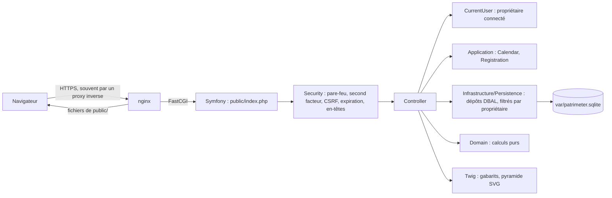

# Architecture

Patrimeter est une application Symfony 7.4 LTS rendue côté serveur (gabarits Twig), avec une base
SQLite et un JavaScript d'amélioration progressive : chaque écran fonctionne sans JavaScript, qui
n'ajoute que du confort (sélecteur de mois, graphique, confirmations).

## Choix techniques

Toutes les briques, avec les alternatives envisagées et la raison de chaque choix :
[choix-techniques.md](choix-techniques.md).

## Couches

- **`src/Domain/`** : calculs purs, sans dépendance à Symfony ni à la base. `Money` (saisie et
  affichage français des montants), `Month`, `Valuation` (report du dernier solde connu, recherche
  dichotomique), `NetWorthCalculator` (patrimoine net par niveau). `Budget/` : budget du foyer (`BudgetOverview`
  calcule les totaux, la règle 50/30/20 et ce qui reste à chacun ; `JointAccount` partage le compte commun ;
  `PrecautionCoverage` et `SavingsTrack` le rapprochent du patrimoine du mois ; `BudgetBook` garde un budget complet
  en mémoire et réunit ceux des membres d'un compte famille ; `Reorder` change l'ordre des catégories et des postes).
  `Goal/` : objectifs d'épargne (`SavingsGoal`, `GoalProgress` : effort nécessaire, rythme des six derniers mois,
  statut, mois projeté). `Trend` : tendances sur 3, 6 et 12 mois. `PyramidAdvice` tire les recommandations du tableau
  de bord de la pyramide du mois.
- **`src/Application/`** : services applicatifs. `Calendar` fournit la date du jour, le mois
  courant et les horodatages UTC, à partir de l'horloge injectée (figée dans les tests).
  `Registration` gère l'inscription et la confirmation de l'adresse e-mail, `PasswordReset` le mot de
  passe oublié, `PropertyPortfolio` les biens et leur valeur nette, `PortfolioService` les lectures et
  écritures communes à l'API et au MCP (`Mcp/` : outils MCP), `Budget/` le budget du foyer lu avec le patrimoine du
  même mois (`HouseholdBudget`), `Transfer/` l'export et l'import des données (`ExportReader` lit un fichier en
  mémoire, sans base), `Carbure/` les dépenses réelles lues dans Carbure (`CarbureBudget`, client MCP
  `Infrastructure\Carbure\CarbureClient`), `Family/` le compte famille (`FamilyPortfolio` : membres importés, périmètres
  famille, membre
  ou ce compte, portefeuille et budget réunis), `Goals/` les objectifs d'épargne (`SavingsGoals` : création,
  suivi, cible en mois de dépenses, épargne prévue au budget), `Demo/` le mode démonstration (`DemoAccounts`,
  `DemoPortfolio` : données d'exemple), `Reminder/` le rappel mensuel par e-mail (`EntryReminders`), `Supervision/`
  l'état servi à la supervision.
- **`src/Infrastructure/Persistence/`** : seul endroit où l'on écrit du SQL (règle PHPStan
  `NoSqlOutsidePersistenceRule`), toujours en requêtes préparées. `Row` convertit les valeurs
  SQLite en types PHP stricts. Les dépôts de données patrimoniales exigent le propriétaire à
  chaque appel.
- **`src/Infrastructure/Mail/`** : envoi des e-mails (`AccountMailer`) et construction du
  transport SMTP. **`src/Infrastructure/Supervision/`** : témoins des tâches de fond (`var/supervision/`).
- **`src/Security/`** : utilisateurs (`User`, `UserProvider`), connexion par e-mail et mot de
  passe (`PasswordLoginAuthenticator`), second facteur (`TwoFactor/` : enrôlement TOTP, codes de
  secours, redirections), propriétaire de la requête (`CurrentUser`) et `OwnedResourceVoter`,
  secrets protégés par la clé serveur (`AuthSecrets`), jetons à usage unique, journal
  (`AuthJournal`), confirmation d'identité (`Reauthentication`), limitation des tentatives
  (`Throttle/`), expiration de session, vérification centralisée du jeton CSRF de tous les POST ;
  `Api/` : jetons porteurs, serveur d'autorisation OAuth, débit par jeton ; `WebAuthn/`, `Vault/` ; sessions ouvertes
  (`UserSessions`) ; restrictions des comptes de démonstration (`DemoGuard`).
- **`src/Http/`** : en-têtes de sécurité de toutes les réponses (`SecurityHeadersSubscriber`), lecture des
  rapports de violation de la CSP (`CspReports`), adresses absolues des e-mails (`PublicUrl`, construites
  depuis `DEFAULT_URI`), visite guidée de la démonstration (`DemoTour`).
- **`src/Application/Form/`** et **`src/Application/Payload/`** : formulaires des pages et corps des requêtes
  de l'API, validés par Symfony Validator ; règles métier qui dépendent de la base dans les services.
- **`src/Application/Maintenance/`** : tâches planifiées (Symfony Scheduler), consommées par le service
  `patrimeter-scheduler`.
- **`src/Command/`** : administration des comptes (`app:user:create`, `app:user:list`, `app:user:set-password`,
  `app:user:reset-2fa`, `app:user:rotate-key`), rotation de `AUTH_SECRET_KEY` (`app:auth-secrets:rotate`),
  alerte d'un service en échec (`app:alert`).
- **`src/Controller/`** : contrôleurs minces, un par écran ; ils lisent la requête, appellent le
  domaine et les dépôts, et rendent un gabarit.
- **`src/Twig/`** : rendu SVG de la pyramide, des flux du budget (`BudgetSankeySvg`), de la jauge de l'épargne
  de précaution (`PrecautionGaugeSvg`) et du graphique de projection d'un objectif (`GoalChartSvg`), données du
  sélecteur de mois, filtres de format, navigation (`NavigationExtension` ; `EntryDueExtension` met en évidence la
  saisie du mois non faite), démonstration (`DemoExtension`) et lien vers la documentation (`DocumentationExtension`).
  Le périmètre d'un compte
  famille est retenu en session (`Http\PerimeterSelection`).

## Cycle d'une requête

1. nginx sert directement les fichiers de `public/` (assets compilés, favicon) ; tout le reste va
   au contrôleur frontal.
2. Le routeur associe l'adresse à un contrôleur (attributs `#[Route]`).
3. `SessionIdleTimeoutSubscriber` (avant le pare-feu) vide une session inactive depuis plus de
   30 minutes ou ouverte depuis plus de 12 heures.
4. Le pare-feu recharge l'utilisateur depuis la base (la session prend fin si son mot de passe ou
   son tampon de session a changé), puis exige d'être connecté, sauf pour la connexion,
   l'inscription et le thème. La supervision (`/sante`) et les rapports de la CSP (`/csp/rapport`) sont hors
   pare-feu, sans session ; l'API et le MCP ont leur propre pare-feu, à jeton porteur. Entre le mot de passe et le code,
   seul le formulaire du code est
   accessible (scheb/2fa-bundle).
5. `CsrfProtectionSubscriber` refuse tout POST sans jeton valide, avant le contrôleur.
6. `AccountGateSubscriber` impose les étapes manquantes : configurer le TOTP, déverrouiller les
   données, noter la clé de récupération. Pour un compte de démonstration (`DEMO_MODE`), `DemoGuard` le remplace :
   seules les pages du patrimoine, de la saisie, des comptes, des biens, du budget et de l'export répondent, les
   écritures sont limitées, et le compte expiré est supprimé. Sa visite guidée (`Http\DemoTour`) garde l'étape en
   cours dans la session et s'affiche dans `base.html.twig` sur la page de cette étape.
7. Le contrôleur obtient le propriétaire auprès de `CurrentUser` (qui refuse toute
   authentification incomplète) et le passe aux dépôts ; `SecurityHeadersSubscriber` ajoute la
   CSP et les autres en-têtes à la réponse.

Parcours d'authentification détaillés (diagrammes) : [auth-flows.md](auth-flows.md).

## Utilisateurs et cloisonnement

Barrières successives, chacune vérifiée par des tests :

1. **Dépôts** : chaque méthode d'`AccountRepository` et de `StatementRepository` exige le
   propriétaire et chaque requête filtre sur `user_id` (test d'architecture
   `OwnedDataQueriesTest`) ; le compte d'un autre utilisateur est introuvable (404).
2. **Voter** : `OwnedResourceVoter` revérifie le propriétaire de chaque compte lu.
3. **SQL confiné** aux dépôts : la règle PHPStan `NoSqlOutsidePersistenceRule` refuse toute
   requête ailleurs dans `src/`.
4. **Base** : `statements (account_id, user_id)` référence `accounts (id, user_id)` : un relevé
   ne peut pas pointer vers le compte d'un autre utilisateur.
5. **Robots de test** : `AccessControlTest` parcourt toutes les routes (anonyme, code en
   attente, TOTP non configuré) ; `IsolationTest` les parcourt avec les identifiants d'un autre
   utilisateur, en lecture et en écriture. `RouteCatalog` classe chaque route : une route non
   classée fait échouer les tests.

**Chiffrement** : chaque donnée est aussi chiffrée avec la clé de son propriétaire et liée à sa ligne : une ligne
déplacée vers un autre compte ne se déchiffre pas ([encryption.md](encryption.md)).

## Thème clair / sombre

- Les couleurs sont des variables CSS. Le jeu sombre s'applique si le système est en sombre et
  que l'utilisateur n'a pas choisi le clair, ou s'il a choisi le sombre (`data-theme="dark"`).
- Le choix est stocké dans le cookie `patrimeter_theme` (`light` ou `dark`, un an). Le serveur
  le relit (`ThemePreference`) et écrit `data-theme` dans la balise `<html>` : la page s'affiche
  dès le départ dans le bon thème, sans script inline.
- Le bouton de l'en-tête est un formulaire (`POST /theme`, `ThemeController`, accessible sans
  connexion, adresse de retour limitée aux chemins internes par `InternalPath`). `app.js`
  l'intercepte pour basculer sans rechargement et prévient le graphique de se redessiner.

## Apparence

- **Couleur d'accent** (`Http\Accent` : `forest`, `ocean`, `aurora`, `slate`) et **densité d'affichage**
  (`Http\Density` : `comfortable`, `compact`), choisies dans Mon compte (`POST /securite/apparence`,
  `AppearanceController`) et retenues par le navigateur dans les cookies `patrimeter_accent` et `patrimeter_density`
  (un an, `HttpOnly`, `SameSite=Lax`). `Http\Appearance` les relit ; `base.html.twig` écrit `data-accent` et
  `data-density` dans `<html>`, seulement pour un choix autre que celui par défaut, et la balise `theme-color` prend
  la teinte claire de l'accent.
- Chaque accent a trois variables par thème (`--accent-ocean`, `--accent-ocean-text`, `--accent-ocean-soft`) ;
  `--primary`, `--primary-text` et `--primary-soft` y renvoient selon `data-accent`. Le thème sombre ne redéfinit que
  les `--accent-*`. `ColorAccessibilityTest` vérifie les contrastes de chaque accent dans les deux thèmes.
- La densité règle quelques variables (`--block-gap`, `--card-padding`, `--control-height`, `--row-padding`,
  `--cell-padding`, `--line-height`) ; la compacte garde des contrôles de 38 pixels de haut.
- **Barre latérale** sur ordinateur, à partir de 1 024 pixels : la barre du haut d'une page connectée devient une
  colonne, en CSS seul (`grid-template`, sélecteur `:has(> .topbar)` : le rapport, sans barre, garde toute la
  largeur).
- **Micro-animations** : toutes dans un bloc `@media (prefers-reduced-motion: no-preference)` d'`app.css`, ce que
  vérifie `MotionTest` ; les tests de bout en bout et les captures demandent la réduction des animations.
- **Icônes** : un seul jeu (`Twig\Icons`, fonction Twig `icon()`), des tracés SVG sur une grille de 24 unités avec le
  même trait arrondi (règle `.icon`) ; un nom inconnu lève une exception, que les tests des pages révèlent.

## Langues

- Interface en français (langue source) et en anglais, avec le composant Translation de Symfony. Les clés sont les
  textes français : la page reste lisible si une traduction manque, et `TranslationCompletenessTest` refuse qu'il en
  manque une. Fichiers : `translations/messages.en.yaml`, `validators.en.yaml` (messages des contraintes),
  `levels.en.yaml` et `account_types.en.yaml` (libellés venus de la base et du domaine).
- Langue d'une requête : celle choisie (cookie `patrimeter_locale`, lu par `LocaleSubscriber` avant le
  `LocaleListener` de Symfony), sinon la préférée du navigateur parmi `enabled_locales` (`fr`, `en`), sinon le
  français. Le bouton à côté du thème affiche la langue en cours et ouvre un menu (`
`, utilisable sans
  JavaScript ; `app.js` le ferme au clic à côté ou avec Échap) dont chaque langue est un bouton de formulaire
  (`POST /langue`, `LocaleController`, accessible sans connexion).
- Textes construits en PHP : `t()` (TranslatableMessage), et `Http\Sentences` pour une suite de phrases (« Trop de
  tentatives. » puis le délai) ; ils se traduisent à l'affichage, messages flash compris. Formats des montants, des
  pourcentages, des dates et des mois selon la langue (`Money`, `Month`, filtres de `AppExtension`).
- Les e-mails partent après la réponse : `AccountMailer` fixe leur langue (`TemplatedEmail::locale`) et traduit le
  sujet au moment de l'appel.
- Hors interface : messages de l'API et du service MCP, commandes de la console, journaux et documentation restent en
  français.

## Données

Schéma : [`migrations/`](../migrations/).

| Table | Contenu |
|---|---|
| `levels` | les six niveaux de la pyramide (référentiel) |
| `account_types` | les 38 types de comptes prédéfinis, avec niveau et nature par défaut |
| `users` | utilisateurs : e-mail, empreinte Argon2id, confirmation, secret TOTP chiffré, tampon de session |
| `backup_codes` | empreintes HMAC des codes de secours, date d'utilisation |
| `one_time_tokens` | jetons envoyés par e-mail : sélecteur, empreinte SHA-256 du vérificateur, expiration |
| `auth_events` | journal des connexions et actions de sécurité (180 jours) |
| `user_sessions` | sessions ouvertes : adresse IP, navigateur, début, dernière activité, déconnexion (12 h après la dernière activité) |
| `savings_goals` | objectifs d'épargne chiffrés ; leur suivi (`Domain\Goal\GoalProgress`) se calcule des relevés |
| `custom_indicators` | indicateurs personnalisés chiffrés ; leurs valeurs (`Domain\Indicator\CustomIndicator`) se calculent des relevés |
| `entry_reminders` | rappel mensuel de saisie choisi par l'utilisateur (jour, langue, dernier envoi) ; envoyé par les tâches planifiées |
| `demo_accounts` | comptes de démonstration (`DEMO_MODE`) et leur fin : supprimés avec leurs données à la déconnexion ou une fois expirés |
| `key_envelopes` | enveloppes de la clé de données (mot de passe, passkey, clé de récupération) |
| `webauthn_credentials` | passkeys et clés de sécurité : clé publique, compteur, usage |
| `accounts` | comptes et crédits d'un utilisateur, chiffrés (nom, type, niveau, nature, ouverture, clôture, bien lié) |
| `statements` | un relevé chiffré par compte et par mois ; suppression en cascade avec le compte |
| `ownership_shares` | quotes-parts chiffrées d'un bien, par mois d'effet |
| `budget_households`, `budget_categories`, `budget_lines`, `budget_months` | budget du foyer, chiffré : foyer, catégories, postes, montants de chaque mois |
| `carbure_links` | lien de chaque utilisateur avec son instance Carbure, chiffré : adresse, jeton, correspondance des catégories |
| `family_members` | compte famille, chiffré : nom de chaque membre et contenu de son dernier fichier d'export importé |
| `oauth_clients`, `oauth_codes`, `api_grants`, `api_tokens` | clients, codes, autorisations et jetons de l'API et de MCP |
| `cache_items` | cache de sécurité (Symfony) : compteurs des limiteurs, codes TOTP déjà utilisés |

Détail des colonnes et des contraintes : [data-model.md](data-model.md).

## Bonnes pratiques de Symfony et de PHP

État au 10/11/2026 au regard des [bonnes pratiques](https://symfony.com/doc/7.4/best_practices.html) et
des [recommandations de performance](https://symfony.com/doc/7.4/performance.html) de Symfony 7.4. Un
écart y est assumé et justifié, ou bien prévu.

| Pratique | État |
|---|---|
| Structure de répertoires par défaut | Suivie. Espace de noms `Patrimeter\` au lieu de `App\` (simple exemple dans la documentation), sous-dossiers `Domain/`, `Application/`, `Infrastructure/` |
| Variables d'environnement pour l'infrastructure | Suivie (`.env`, `.env.local`, [.env.example](../.env.example)) |
| Coffre de secrets de Symfony | **Écart assumé** : chaque installation produit ses propres secrets, qui restent dans `.env.local` hors du dépôt (contrainte du projet) ; un coffre chiffré versionné n'apporte rien à une application auto-hébergée |
| Paramètres courts préfixés `app.`, constantes pour ce qui change rarement | Suivie |
| Pas de bundle pour le code de l'application, injection automatique, services privés, configuration YAML minimale | Suivie : réglages à côté du code par attributs (`#[Autowire]`, `#[AsAlias]`, `#[AsMiddleware]`…), YAML seulement pour les classes tierces ; services publics en test seulement |
| Correspondance Doctrine par attributs | Sans objet : DBAL seul, pas d'ORM (SQL explicite, chiffrement par ligne) |
| Contrôleurs qui étendent `AbstractController`, injection des services | Suivie, API comprise |
| Routes, sécurité par attributs | Routes par attributs ; accès par `access_control` (règles par préfixe d'URL) et voters (`OwnedResourceVoter`) |
| Gabarits en snake_case, fragments préfixés par `_` | Suivie ; seules exceptions, les variables imposées par scheb/2fa-bundle (`authCodeParameterName`…) |
| **Formulaires en classes PHP (composant Form)** | **Écart** : formulaires HTML écrits dans les gabarits, données validées par le Validator de Symfony (`Application/Form/`), jeton CSRF vérifié de façon centralisée. Migration vers le composant Form à décider |
| Traductions XLIFF et clés de traduction | **Écart assumé** : catalogues YAML, et texte français comme clé (lisible dans les gabarits, page lisible si une traduction manque) ; complétude vérifiée par un test |
| Un seul pare-feu | Pare-feu `main` pour le site ; `api` à part, car l'authentification y est distincte (jetons porteurs, sans session), cas prévu par la règle ; points d'accès publics du serveur d'autorisation OAuth hors pare-feu (`oauth_endpoints`) |
| Hacheur `auto` | **Écart assumé** : Argon2id explicite (`auto` choisit aujourd'hui bcrypt), recommandé par l'OWASP et déjà utilisé pour dériver les clés de chiffrement |
| Voters pour les autorisations fines | Suivie |
| AssetMapper | Suivie, sans importmap (CSP) |
| Tests de fumée de toutes les URL, URL écrites en dur dans les tests | Suivie (`tests/Support/RouteCatalog.php`, robots d'accès et de cloisonnement) |
| Aucune dépréciation | Suivie : PHPUnit échoue sur toute dépréciation, notice ou avertissement, celles de Symfony et de Doctrine comprises (configuration de la recette de Symfony, en plus strict) ; `tools/container-deprecations.sh` (CI) refuse celles que signale la compilation du conteneur, dont les signatures à changer pour Symfony 8. Seule exception justifiée : `SqlOnlySchemaDiffProvider` implémente une interface interne de Doctrine Migrations |
| Conteneur en un seul fichier (`.container.dumper.inline_factories`) | Suivie |
| OPcache : mémoire, dates non vérifiées | Suivie ([php-fpm/patrimeter-opcache.ini](php-fpm/patrimeter-opcache.ini)) |
| Préchargement OPcache (`opcache.preload`) | **Écart assumé** : php-fpm applique `disable_functions` du pool après le préchargement, et le code préchargé appelle alors une mauvaise fonction interne (constaté en CI) ; la restriction des fonctions l'emporte |
| Cache des chemins (`realpath_cache`) | **Écart assumé** : PHP le désactive avec `open_basedir`, gardé pour isoler le pool |
| Chargeur Composer en classmap autoritaire, sans dépendances de développement | Suivie (`--no-dev --classmap-authoritative`) |
| `dump-env` (variables d'environnement compilées) | **Écart assumé** : gain négligeable ici, et une modification de `.env.local` serait ignorée jusqu'au prochain `dump-env` |

Côté PHP :

| Pratique | État |
|---|---|
| Normes du PHP-FIG | PSR-4 (chargement), PER Coding Style 3.0 (PHP-CS-Fixer), PSR-3 (journaux), PSR-11 (conteneur), PSR-20 (horloge injectée, jamais `date()` ni `new DateTime()`) |
| Typage strict | `declare(strict_types=1)` partout ; PHPStan au niveau max avec règles strictes et Psalm au niveau 1, sans aucune exception ni base d'erreurs ignorées |
| Classes | Toutes `final` ; propriétés `readonly` et promotion dans le constructeur ; énumération pour les niveaux |
| `#[\Override]` (PHP 8.3) | Sur toute méthode qui en redéfinit une autre, exigé par PHPStan et Psalm (migrations publiées exceptées : jamais modifiées) |
| `#[\SensitiveParameter]` | Sur tout paramètre qui porte un secret (mot de passe, clé, jeton, code) : absent des traces d'erreur |
| Sécurité du code | Requêtes préparées seulement ; aléa de `random_bytes()` ; comparaisons de secrets par `hash_equals()` ; aucune suppression d'erreur par `@`, aucune superglobale, aucun `unserialize()` de données externes |
| Modernisations possibles, non faites | Énumérations pour la nature d'un compte et le mode d'un crédit (aujourd'hui des chaînes contrôlées) ; constantes de classe typées (PHP 8.3) ; classes `readonly` ; commandes invocables de Symfony 7.3 (`__invoke` et `#[Argument]`) |

## Tests

| Suite | Contenu |
|---|---|
| `tests/Unit` | domaine, rendu, outils, sans base ni noyau |
| `tests/Integration` | dépôts, limitation, mot de passe, commande, migrations  |
| `tests/Functional` | requêtes HTTP réelles : connexion et second facteur, inscription, page Mon compte, CSRF, en-têtes, écrans, robots de contrôle d'accès et de cloisonnement, pages d'erreur |
| `tests/Regression` | résultats de calcul identiques à la v1, en calcul pur et à travers la base |
| `tests/Architecture` | règles vérifiées sur le code (requêtes filtrées par propriétaire) |
| `tests/e2e`, `tests/dast`, `tests/perf` | parcours Playwright, ZAP et k6, sur `php -S` en mode production |
| `tests/deployment` | serveur réel installé selon la documentation : nginx, php-fpm, HTTPS, sauvegarde, restauration |

Chaque test s'exécute dans une transaction annulée à la fin (`dama/doctrine-test-bundle`) ; l'horloge
est figée au 15 novembre 2026 à midi. Détail de la CI : [ci.md](ci.md).
