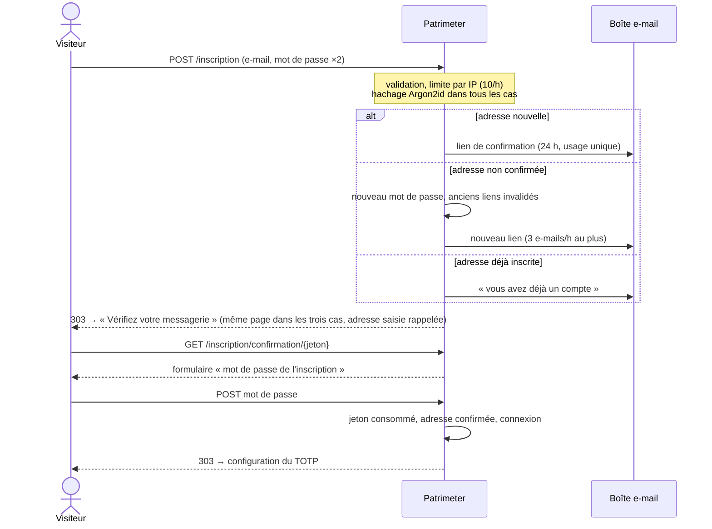
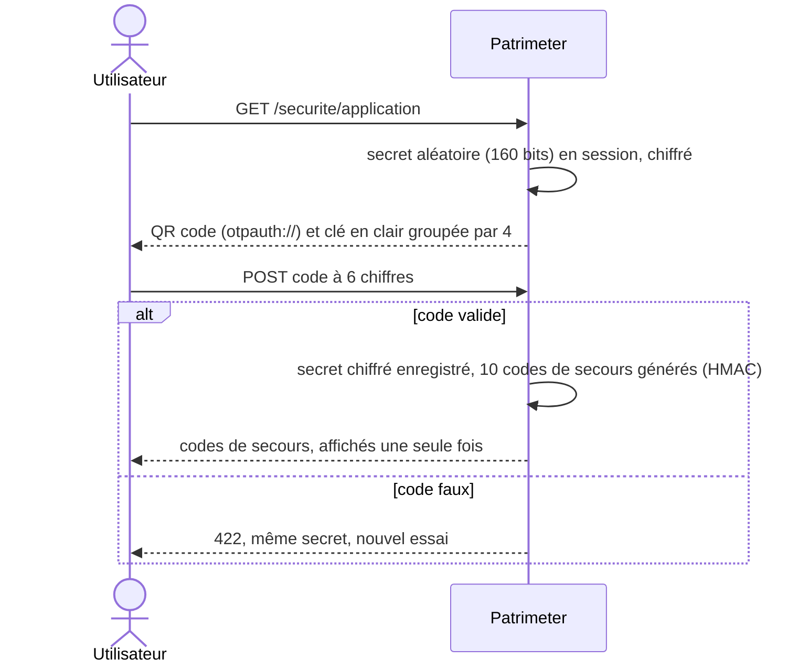
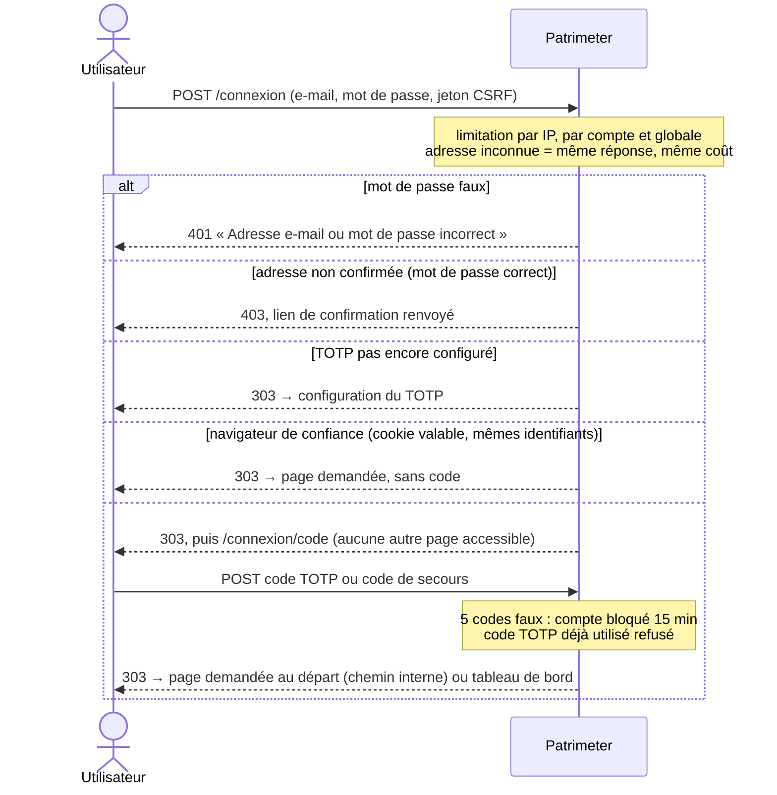
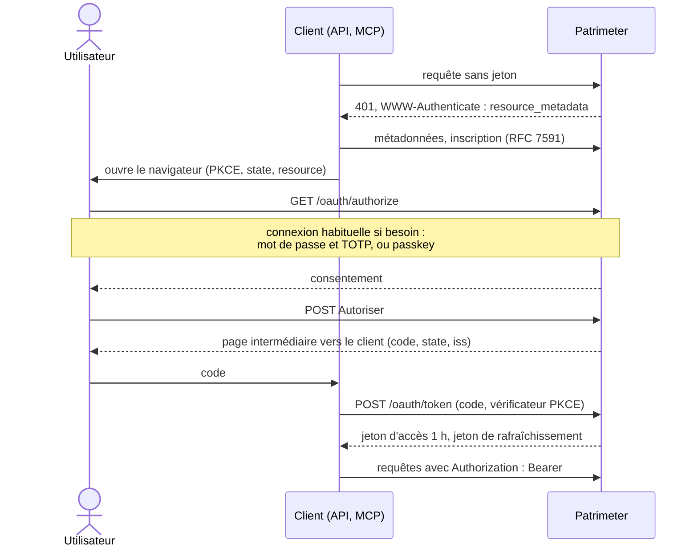
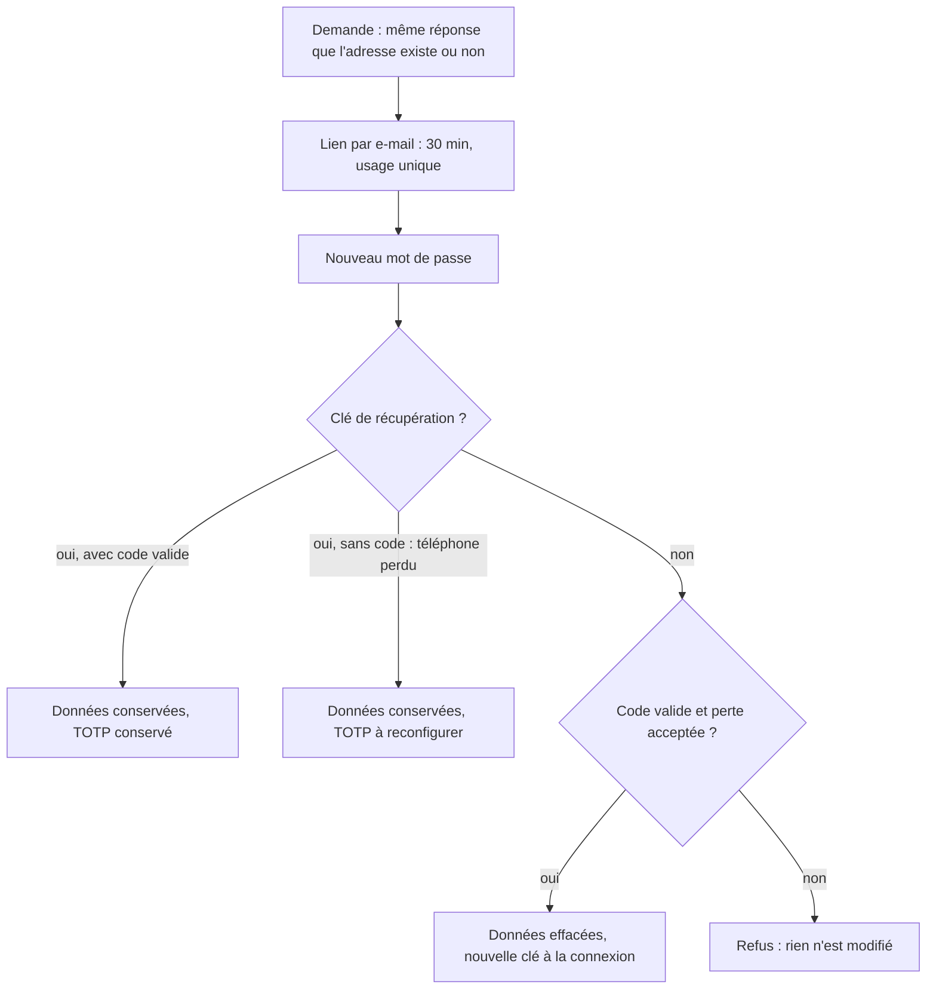
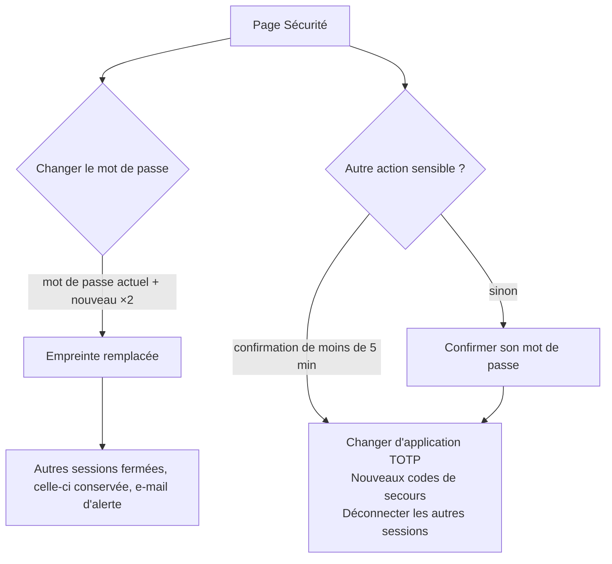

# Parcours d'authentification

Toutes les pages sont rendues par le serveur ; chaque formulaire porte le jeton CSRF de la
session et chaque redirection après un POST est un 303.

## Inscription et confirmation de l'adresse

La confirmation exige le lien reçu par e-mail **et** le mot de passe choisi : quelqu'un qui
inscrirait l'adresse d'autrui ne peut pas faire activer son compte par la victime.

Une inscription jamais confirmée est supprimée par la tâche planifiée horaire (`Registration::purgeUnconfirmed`)
24 heures après le dernier lien envoyé, sauf si elle a des comptes ; jamais un compte de démonstration (sa propre
durée de vie) ni un compte sans adresse. L'adresse redevient libre.

## Première connexion : configuration du TOTP

Obligatoire : tant qu'elle n'est pas faite, toute autre page renvoie vers elle
(`EnrollmentRequiredSubscriber`) et les dépôts refusent l'utilisateur (`CurrentUser`).

## Connexion

**Navigateur de confiance** (`TrustedBrowsers`, `SecondFactorCondition`) : la case « Faire confiance à ce
navigateur » cochée avec un code valide, le serveur pose un cookie aléatoire `<sélecteur>.<secret>` (`HttpOnly`,
`SameSite=Strict`, `Secure` et préfixe `__Host-` en HTTPS) pour 30 jours et ne garde que l'empreinte du secret, avec
l'empreinte des identifiants du moment. À la connexion suivante, un cookie valable pour ce compte et ces identifiants
dispense du code (le mot de passe reste exigé) ; un nouveau mot de passe ou la fermeture des autres sessions
(renouvellement du tampon de session) le rendent caduc. Chaque navigateur se retire depuis Connexion et sécurité.

## Passkeys (FIDO2) et clés de sécurité

- **Passkey** : identifiant découvrable, vérification de l'utilisateur exigée, aucun second facteur
  demandé. La sortie PRF ouvre les données si l'appareil la fournit.
- **Clé de sécurité** : en second facteur seulement, à la place du code, sur la même page et avec la
  même limitation. Une passkey peut aussi servir de second facteur.
- Défi aléatoire à usage unique en session, propre à chaque cérémonie ; origine limitée à `DEFAULT_URI` ; compteur vérifié.

## API et service MCP

Mêmes facteurs que le site : le client ne voit jamais le mot de passe. Détail : [api.md](api.md).

Le départ vers le client passe par une page, et non une redirection : Chromium applique la CSP
`form-action` aux redirections qui suivent un formulaire.

## Étapes obligatoires après la connexion

`AccountGateSubscriber` les impose dans l'ordre, en redirigeant toute autre requête : configurer le
TOTP, déverrouiller les données si la clé de session est perdue (cookie effacé), noter la clé de
récupération (affichée une fois, confirmée par ses deux derniers groupes).

## Mot de passe oublié

## Actions sensibles

## Fin de session

- Déconnexion (POST avec jeton), possible aussi pendant la saisie du code.
- 30 minutes sans activité, ou 12 heures après la connexion.
- Changement du mot de passe, « déconnecter mes autres sessions », réinitialisation par
  l'administrateur : l'utilisateur, rechargé à chaque requête, ne correspond plus à celui de la
  session (empreinte du mot de passe ou tampon de session différents).
