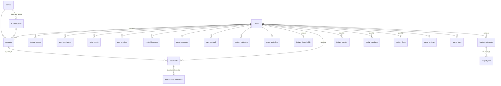

# Modèle de données

Base SQLite unique (`var/patrimeter.sqlite`), schéma créé par les migrations en SQL explicite
([`migrations/`](../migrations/)). Montants en centimes (entiers), mois au format `AAAA-MM`,
dates `AAAA-MM-JJ`, horodatages UTC `AAAA-MM-JJTHH:MM:SSZ`.

## Utilisateurs et authentification

| Table | Colonnes | Remarques |
|---|---|---|
| `users` | `id` (UUID v7), `email` (unique, minuscules), `password_hash`, `email_verified_at`, `totp_secret`, `totp_enabled_at`, `session_stamp`, `email_locale`, `created_at` | `totp_secret` : chiffré (XChaCha20-Poly1305, clé `AUTH_SECRET_KEY`, données associées = utilisateur). `session_stamp` : changé pour fermer toutes les sessions. `email_locale` : langue des e-mails choisie dans le profil (`fr`, `en`, ou NULL : celle de l'interface à l'envoi). |
| `backup_codes` | `user_id`, `code_hash`, `used_at`, `created_at` | Clé primaire `(user_id, code_hash)`. HMAC-SHA256 avec une sous-clé de `AUTH_SECRET_KEY` : jamais le code. |
| `one_time_tokens` | `selector`, `user_id`, `purpose`, `verifier_hash`, `expires_at`, `used_at`, `created_at` | Jeton = sélecteur + vérificateur ; seule l'empreinte SHA-256 du vérificateur est stockée. Usage unique (consommation atomique). |
| `auth_events` | `id`, `user_id`, `type`, `success`, `ip`, `user_agent`, `created_at` | Journal visible par l'utilisateur, purgé après 180 jours. |
| `user_sessions` | `id`, `user_id`, `ip`, `user_agent`, `created_at`, `last_seen_at`, `revoked_at` | Sessions ouvertes, listées dans Connexion et sécurité ; identifiant aléatoire gardé dans la session (jamais l'identifiant PHP), purgées 12 h après leur dernière activité. |
| `trusted_browsers` | `id` (sélecteur), `user_id`, `verifier_hash`, `fingerprint`, `ip`, `user_agent`, `created_at`, `last_used_at`, `expires_at` | Navigateurs de confiance (second facteur non redemandé pendant 30 jours) : empreinte du secret du cookie, jamais le cookie ; empreinte des identifiants du moment (nouveau mot de passe ou sessions fermées : caducs) ; purgés à expiration. |
| `savings_goals` | `id`, `user_id`, `ciphertext`, `created_at` | Objectifs d'épargne : nom, montant et mois cibles, périmètre (patrimoine net, niveau ou comptes), point de départ, chiffrés (contexte `savings_goals:<ligne>:<propriétaire>:1`). Le suivi (statut, rythme) se recalcule à chaque affichage. |
| `custom_indicators` | `id`, `user_id`, `ciphertext`, `created_at` | Indicateurs personnalisés : nom, niveaux et comptes choisis, part du patrimoine net ou non, chiffrés (contexte `custom_indicators:<ligne>:<propriétaire>:1`). Les valeurs se recalculent à chaque affichage. |
| `entry_reminders` | `user_id`, `day`, `locale`, `last_sent_month`, `unsubscribe_hash` | Rappel mensuel de saisie par e-mail, au choix de l'utilisateur : jour, langue, dernier mois envoyé, empreinte SHA-256 du lien de désabonnement du dernier e-mail. En clair : aucune donnée patrimoniale. |
| `demo_accounts` | `user_id`, `expires_at` | Comptes de démonstration (`DEMO_MODE`) : utilisateur sans mot de passe ni TOTP, adresse en `@demo.invalid`, clé de données seulement en session ; supprimé avec ses données à la déconnexion, ou par les tâches planifiées une fois `expires_at` passé. |
| `cache_items` | `item_id`, `item_data`, `item_lifetime`, `item_time` | Pool de cache `cache.security` (Symfony, `DoctrineDbalAdapter`) : compteurs des limiteurs et codes TOTP déjà utilisés. Clés hachées, aucune adresse e-mail en clair. |

Toutes les tables liées à un utilisateur le référencent avec `ON DELETE CASCADE`.

`webauthn_credentials` : `credential_id`, `user_id`, `usage`, `label`, `record` (clé publique et
compteur, aucun secret), `created_at`, `last_used_at`.

## Données patrimoniales

| Table | Colonnes | Remarques |
|---|---|---|
| `key_envelopes` | `user_id`, `type`, `credential_id`, `salt`, `ops_limit`, `mem_limit`, `wrapped_key`, `created_at` | Clé de données enveloppée par moyen de déverrouillage. |
| `accounts` | `id`, `user_id`, `ciphertext`, `created_at` | Chiffré : nom, type, niveau, nature, ouverture, clôture, et pour un crédit le bien lié et le mode (`prorata` ou `own`), sans clé étrangère : ce lien n'est donc pas visible en base. `UNIQUE (id, user_id)` : cible de la clé étrangère composite des relevés. |
| `statements` | `account_id`, `user_id`, `month`, `ciphertext`, `updated_at` | Chiffré : montant. Clé primaire `(account_id, month)`. `FOREIGN KEY (account_id, user_id) REFERENCES accounts (id, user_id) ON DELETE CASCADE` : un relevé appartient forcément au propriétaire de son compte. |
| `approximate_statements` | `user_id`, `account_id`, `month` | Soldes approximatifs (3.1.0) : relevés des premiers comptes créés par les pages de bienvenue, marqués « à affiner » dans la saisie du mois jusqu'à ce qu'ils soient enregistrés de nouveau (`StatementRepository::save` retire la marque). Clé primaire `(account_id, month)`, `FOREIGN KEY (account_id, month) REFERENCES statements ON DELETE CASCADE`. Aucun montant : en clair, comme les mois des relevés. |
| `ownership_shares` | `account_id`, `user_id`, `effective_month`, `ciphertext` | Chiffré : part en millionièmes. Clé primaire `(account_id, effective_month)`. Même clé étrangère composite que les relevés. |
| `budget_households` | `user_id`, `ciphertext`, `updated_at` | Chiffré : prénoms des adultes et des enfants, cible de l'épargne de précaution en mois. Un foyer par utilisateur. |
| `budget_categories` | `id`, `user_id`, `ciphertext`, `position`, `created_at` | Chiffré : nom, famille (`needs`, `wants`, `savings`), adulte qui la paie (vide : budget commun). `UNIQUE (id, user_id)` : cible de la clé étrangère composite des postes. |
| `budget_lines` | `id`, `user_id`, `category_id`, `ciphertext`, `position`, `created_at` | Chiffré : nom, enfant et compte d'épargne éventuels ; la catégorie fait partie des données associées. `FOREIGN KEY (category_id, user_id) REFERENCES budget_categories (id, user_id) ON DELETE CASCADE`. |
| `budget_months` | `user_id`, `month`, `ciphertext`, `updated_at` | Chiffré : revenus de chaque adulte, partage du compte commun, montant de chaque poste. Clé primaire `(user_id, month)` ; les montants d'un mois valent pour les suivants jusqu'au prochain enregistrement. |
| `carbure_links` | `user_id`, `ciphertext`, `updated_at` | Chiffré : adresse de l'instance Carbure de l'utilisateur, jeton d'API, catégories de dépenses de Carbure et leur correspondance avec celles du budget. Une ligne au plus par utilisateur. |
| `family_members` | `id`, `user_id`, `ciphertext`, `created_at` | Compte famille, deux membres au plus. Chiffré : nom du membre, dates du dernier import et du fichier, comptes et budget de son fichier d'export (format « patrimeter », validé), remplacés à chaque import. `UNIQUE (id, user_id)`. |
| `game_settings` | `user_id`, `enabled`, `saver_style`, `first_steps_hidden` | Défis et étoiles (3.0.0) : jeu affiché ou non, style d'épargnant déclaré (`ant`, `project`, `home`, `horizon` ou NULL), carte « Premiers pas » masquée. Une ligne au plus par utilisateur, absente tant qu'il n'a rien réglé (valeurs par défaut). Aucun montant : en clair. |
| `game_stars` | `user_id`, `challenge`, `stars`, `earned_on` | Meilleures étoiles de chaque défi et jour où elles ont été atteintes. Clé primaire `(user_id, challenge)`. Les défis se recalculent à chaque visite à partir des données chiffrées ; cette table garde seulement le meilleur résultat (jamais baissé), pour qu'une étoile gagnée ne se perde pas. Aucun montant : en clair. |

## API et MCP

| Table | Colonnes | Remarques |
|---|---|---|
| `oauth_clients` | `client_id`, `client_name`, `redirect_uris`, `created_at` | Clients publics, sans secret ; une adresse de retour par ligne. |
| `oauth_codes` | `selector`, `user_id`, `client_id`, `redirect_uri`, `code_challenge`, `scope`, `resource`, `verifier_hash`, `wrapped_key`, `expires_at`, `used_at` | Usage unique, 60 s. |
| `api_grants` | `id`, `user_id`, `client_id`, `name`, `scope`, `resource`, `fingerprint`, `expires_at`, `created_at`, `last_used_at` | `client_id` vide : jeton personnel. `fingerprint` : empreinte du mot de passe et du tampon de session. |
| `api_tokens` | `selector`, `grant_id`, `kind`, `verifier_hash`, `wrapped_key`, `expires_at`, `used_at` | Empreinte du secret ; clé de données enveloppée sous une clé dérivée du secret. |

## Référentiels (communs)

| Table | Contenu |
|---|---|
| `levels` | les six niveaux de la pyramide (code, libellé, étage, ordre) |
| `account_types` | les 38 types de comptes, avec niveau et nature par défaut |

## Visible par l'administrateur

Un administrateur qui lit la base ne voit aucun nom de compte ni montant. Il voit : les adresses
e-mail, le nombre de comptes, de relevés et de parts, les mois saisis, le nombre de membres d'un compte famille, les
dates techniques, la langue choisie pour les e-mails, le journal des connexions et les sessions ouvertes (voir
[SECURITY.md](../SECURITY.md)).
