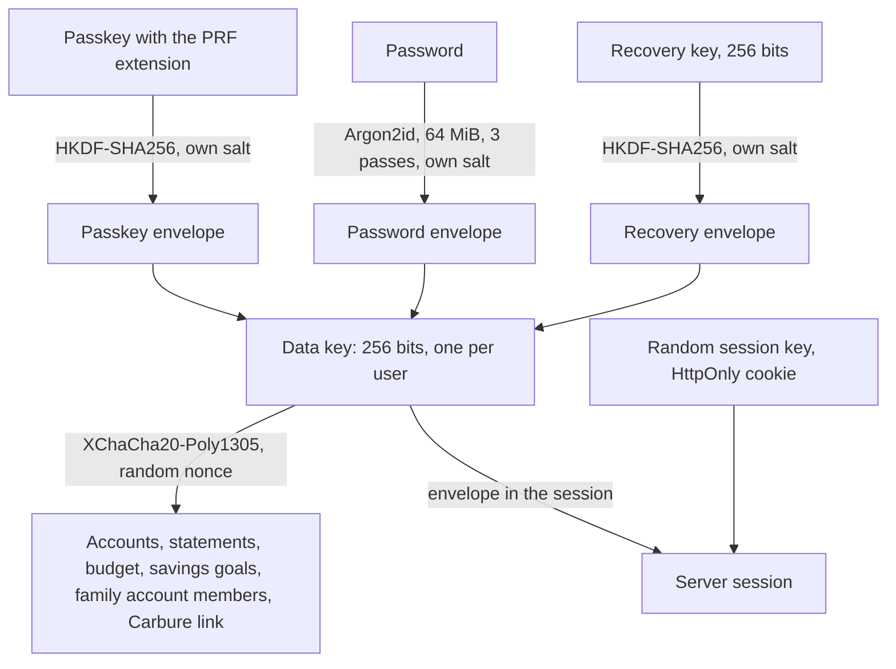

# Encryption and key management

## What is guaranteed

**Passive access is not enough to read wealth data**: the database, backups, session files and logs contain no
account names, types, dates or amounts in clear text, nor anything of the household budget (first names,
categories, items, income, amounts).

**Limit**: an *active* administrator who changes the code can capture a password at the next sign-in, or read
PHP's memory. This is true of any web application, including with encryption in the browser, since the server
would then provide the JavaScript.

What remains visible: email addresses, number of accounts, statements and ownership shares, months entered, number
of budget categories and items and the months in which its amounts were saved, technical dates, sign-in log, open
sessions (IP address, browser, dates).

## Key hierarchy

libsodium only, no home-made cryptography.

- **Data**: each ciphertext is bound to its table, its row, its owner and a version (associated data): copied
  elsewhere or modified, it does not decrypt.
- **Family account**: a member's imported export file is encrypted with the family account's data key (context
  `family_members:<row>:<owner>:1`); the member's account has no access to it, and the family account never reads
  the member's data anywhere but in this file.
- **Creation**: the data key is created at the first sign-in, the only moment when the password is known. A
  registration that was never confirmed therefore has no key.
- **During the session**: the key is wrapped again under a random key that only lives in an `HttpOnly`,
  `SameSite=Strict` cookie (`Secure` over HTTPS). The server only keeps the envelope and rebuilds the key at
  every request. Reading `var/sessions` is not enough to decrypt.
- **Demo accounts** (`DEMO_MODE`): random data key, without any envelope; it only lives in the session, and the
  account is deleted at sign-out or when it expires.
- **API and MCP tokens**: each token carries a copy of the data key, wrapped under a key derived from its secret
  (HKDF-SHA256), which the server does not keep; it only keeps its hash. See [api.md](api.en.md).
- **TOTP secrets**: readable before unlocking, so encrypted with the `AUTH_SECRET_KEY` server key. They are
  protected against a database leak, not against root.
- **Password change**: only the envelope is redone, the data is not encrypted again.
- **Rotation** (compromise): `bin/console app:user:rotate-key <email>` encrypts everything again with a new key
  and closes the sessions. Only the password provided wraps the new key: the recovery key
  is cancelled, and passkeys no longer unlock until they are registered again.

## Consequences for users

| Situation | Consequence |
|---|---|
| Forgotten password, recovery key available | Data kept (email + key). With a valid code, TOTP is kept; without a code, it must be set up again. |
| Forgotten password, no key | Access restored (email + code), but **data permanently erased** after confirmation. The administrator cannot recover anything. |
| Lost phone | Backup codes; failing that, email + recovery key. |
| Passkey without PRF (support varies between browsers) | Sign-in possible, then the password is asked to unlock. |
| Session cookie lost | Unlock screen: the password is asked again. |

## For the administrator

- `app:user:set-password` cannot keep the data without the old password: `--erase-data` is required as soon as
  the account has a key.
- Losing `AUTH_SECRET_KEY` makes the TOTP secrets unreadable (`app:user:reset-2fa` for each user), but not the
  data.
- No rollback of the migration once data has been encrypted.
