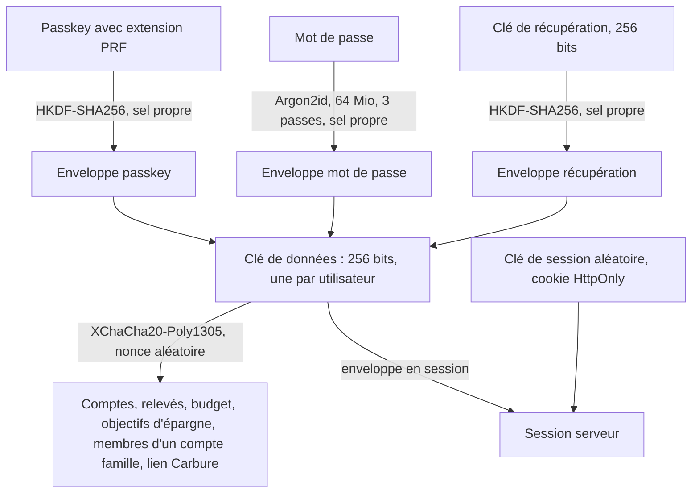

# Chiffrement et gestion des clés

## Ce qui est garanti

**Un accès passif ne suffit pas à lire les données patrimoniales** : base, sauvegardes, fichiers de
session et journaux ne contiennent ni noms de comptes, ni types, ni dates, ni montants en clair, ni rien du budget
du foyer (prénoms, catégories, postes, revenus, montants).

**Limite** : un administrateur *actif* qui modifie le code peut capturer un mot de passe à la connexion
suivante, ou lire la mémoire de PHP. C'est vrai de toute application web, y compris avec un chiffrement
dans le navigateur, puisque le serveur fournirait alors le JavaScript.

Restent visibles : adresses e-mail, nombre de comptes, de relevés et de quotes-parts, mois saisis, nombre de
catégories et de postes du budget et mois où ses montants ont été enregistrés, dates techniques, journal des
connexions, sessions ouvertes (adresse IP, navigateur, dates).

## Hiérarchie des clés

Uniquement libsodium, aucune cryptographie maison.

- **Données** : chaque chiffré est lié à sa table, sa ligne, son propriétaire et une version (données
  associées) : copié ailleurs ou modifié, il ne se déchiffre pas.
- **Compte famille** : le fichier d'export d'un membre, importé, est chiffré avec la clé de données du compte
  famille (contexte `family_members:<ligne>:<propriétaire>:1`) ; le compte du membre n'y a pas accès, et le compte
  famille ne lit jamais les données du membre ailleurs que dans ce fichier.
- **Création** : la clé de données est créée à la première connexion, seul moment où le mot de passe
  est connu. Une inscription jamais confirmée n'a donc pas de clé.
- **Pendant la session** : la clé est réenveloppée sous une clé aléatoire qui ne vit que dans un cookie
  `HttpOnly`, `SameSite=Strict` (`Secure` en HTTPS). Le serveur ne garde que l'enveloppe et reconstitue
  la clé à chaque requête. Lire `var/sessions` ne suffit pas à déchiffrer.
- **Comptes de démonstration** (`DEMO_MODE`) : clé de données aléatoire, sans aucune enveloppe ; elle ne vit que
  dans la session, et le compte est supprimé à la déconnexion ou à son expiration.
- **Jetons d'API et MCP** : chaque jeton porte une copie de la clé de données, enveloppée sous une clé dérivée
  de son secret (HKDF-SHA256), que le serveur ne conserve pas ; il n'en garde que l'empreinte. Voir [api.md](api.md).
- **Secrets TOTP** : lisibles avant le déverrouillage, donc chiffrés avec la clé serveur
  `AUTH_SECRET_KEY`. Ils sont protégés contre une fuite de la base, pas contre root.
- **Changement de mot de passe** : seule l'enveloppe est refaite, les données ne sont pas rechiffrées.
- **Rotation** (compromission) : `bin/console app:user:rotate-key <e-mail>` rechiffre tout avec une
  nouvelle clé et ferme les sessions. Seul le mot de passe fourni enveloppe la nouvelle
  clé : la clé de récupération est annulée, et les passkeys ne déverrouillent plus jusqu'à leur réenregistrement.

## Conséquences pour l'utilisateur

| Situation | Conséquence |
|---|---|
| Mot de passe oublié, clé de récupération disponible | Données conservées (e-mail + clé). Avec un code valide, le TOTP est conservé ; sans code, il est à reconfigurer. |
| Mot de passe oublié, pas de clé | Accès rétabli (e-mail + code), mais **données définitivement effacées** après confirmation. L'administrateur ne peut rien récupérer. |
| Téléphone perdu | Codes de secours ; à défaut, e-mail + clé de récupération. |
| Passkey sans PRF (prise en charge inégale selon les navigateurs) | Connexion possible, puis mot de passe demandé pour déverrouiller. |
| Cookie de session perdu | Écran de déverrouillage : le mot de passe est redemandé. |

## Pour l'administrateur

- `app:user:set-password` ne peut pas conserver les données sans l'ancien mot de passe : `--erase-data`
  est exigé dès que le compte a une clé.
- Perdre `AUTH_SECRET_KEY` rend les TOTP illisibles (`app:user:reset-2fa` pour chaque utilisateur),
  mais pas les données.
- Pas de retour arrière de la migration une fois des données chiffrées.
